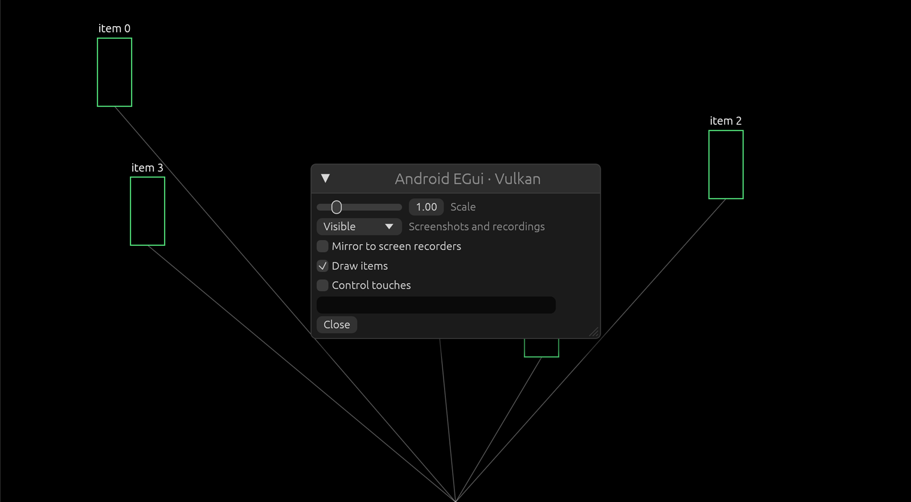

# android-egui

external egui overlay for android, drawn straight from a root binary. no apk, no zygisk, no
injecting into anything: it runs as its own process. you push one ELF, run it with `su`, and get
an [egui](https://github.com/emilk/egui) menu on top of the whole screen.

rust + egui, three render backends (OpenGL ES, Vulkan, CPU) and one binary for android 5 → 17.



```rust
use android_egui::{ANativeWindowCreator, Graphics, GraphicsApi, Result, Touch, egui};

fn main() -> Result<()> {
    let window = ANativeWindowCreator::create("my-overlay")?;
    let mut graphics = Graphics::create(&window, GraphicsApi::Auto)?;
    let _touch = Touch::init(&mut graphics)?;
    let mut name = String::new();
    while graphics.frame(|ui| {
        egui::Window::new("Menu").show(ui.ctx(), |ui| {
            ui.text_edit_singleline(&mut name);
        });
    })? {}
    Ok(())
}
```

thats the whole thing: a window over the screen, graphics that draw into it, touches. the full
demo (menu, scale slider, capture modes, touch control, moving "items") is
[src/main.rs](src/main.rs), ~80 lines.

## Quick start

grab a binary for your abi from **Releases**, then

```bash
adb push android-egui-arm64-v8a /data/local/tmp/android-egui
adb shell "chmod 755 /data/local/tmp/android-egui; su -c /data/local/tmp/android-egui"
```

first arg picks the backend: `auto` (default), `gl`, `vk`, `cpu`.

| env | what it does |
|---|---|
| `ANDROID_EGUI_LOG=debug` | log level (`trace` / `debug` / `info` / `warn` / `error` / `off`), goes to stderr and logcat |
| `ANDROID_EGUI_TOUCH=system` | take touches from the system input monitor instead of evdev |

## What it can do

| | |
|---|---|
| layer | android 5-17. every `libgui.so` call is picked by which symbol actually exists, not by version number, so a weird rom gives you an `Err` instead of a segfault. rotation is followed live |
| backends | OpenGL ES 3/2, Vulkan 1.0+, and a CPU rasterizer in safe rust. `GraphicsApi::Auto` tries them in that order |
| touches | read only by default - the app under the overlay keeps getting its touches like nothing happened |
| control mode | `touch.set_control(true)`: touches on the menu stop reaching the app, and you get `down / move_to / up / tap / swipe` from code - your own fingers in their own slots, alongside the real ones |
| keyboard | own on-screen EN/RU keyboard (letters, two symbol pages, an edit page with select all / cut / copy / paste / undo / arrows) + hardware keyboards with Ctrl+A/C/X/V/Z, autorepeat, layout switch |
| clipboard | the real system one: copy in the overlay, paste in any app, and back |
| capture | `Capture::Visible / Hidden / Secure` - keep the overlay out of screenshots and recordings |
| mirroring | on android 14+ recorders only see window manager layers, so they miss the overlay. `window.set_mirroring(true)` copies it onto the recording display. off by default, and does nothing while the overlay is hidden |
| draw | plain egui: a painter on the background layer draws lines, boxes, circles, text and pictures under the windows and never takes touches |
| pictures | PNG / JPEG from memory or a file, or raw RGBA. works the same on all three backends |
| no evdev | containers without touch devices: touches come from the system input monitor (android 10+) |

## Tested on

everything below ran the full device test suite (touches in all 4 rotations, keyboards, clipboard,
control mode, every backend pixel-compared against the others, capture, recording) with the exact
build thats in Releases.

| android | where | backends | control mode | `Hidden` | recorder | input monitor |
|---|---|---|---|---|---|---|
| 5.0, 5.1, 6.0, 7.0, 7.1 | emulator | GL, CPU | no uinput in those kernels | not before 8.1 | - | - |
| 8.0 | emulator | GL, CPU | yes | not before 8.1 | - | - |
| 8.1 | emulator | GL, CPU | yes | yes | - | - |
| 9 | BlueStacks 5 (x86_64 + x86), emulator | GL, CPU | yes on BlueStacks | yes | - | - |
| 10 | emulator | GL, Vulkan | yes | yes | - | yes |
| 11 | emulator (x86_64 + x86) | all three | yes | yes | - | yes |
| 12, 12L, 13 | emulator | all three | yes | yes | - | yes |
| 14 | emulator | all three | yes | yes | stock recorder | yes |
| 15 | real tablet, arm64, Snapdragon 8 Elite | all three | yes | yes | vendor recorder | yes |
| 16 | emulator: AOSP with root + Google Play image without root | all three | yes (root) | yes | stock recorder, with and without root | yes with root |
| 17 | emulator, canary (API 37), 16 KB pages | all three | yes | yes | stock recorder | yes |

"-" means that android version doesnt have the feature (recorders before 14 grab the whole
screen anyway, input monitor showed up in 10).

not checked, because the test images dont have it:

- Vulkan below android 10 (no driver in the emulator images, no Vulkan at all before 7)
- CPU backend on the android 10 emulator image - that image doesnt show *any* software-drawn layer
- control mode on android 5-7.1 and 9 emulator images (kernel has no uinput). works on BlueStacks 9
- `armeabi-v7a` builds fine but never ran anywhere, nothing here executes 32-bit arm. arm64, x86_64
  and x86 are all tested

## Touches

read straight from `/dev/input`, classified by what the device can do, not by its name:

- multitouch protocol B (slots) - normal phones and tablets
- multitouch protocol A (frames), including panels with no tracking ids and no `BTN_TOUCH`
- single-touch panels
- hover, pressure, palm; hotplug; all four rotations; panels tied to one of several displays
- mice with absolute coordinates (emulators) work as a pointer, wheel scrolls

emulators: BlueStacks 5 and the Android Studio emulator (old `qwerty2` panel and the newer
virtio multi-touch) are tested live. Genymotion, LDPlayer, Nox, MEmu, MuMu and plain
QEMU/VirtualBox are covered by unit tests over their device descriptions, not run for real.

not supported / not checked:

- relative mice (usb / bluetooth) - only the system knows where the cursor is
- Waydroid / redroid / Anbox: the input monitor path exists and is tested on normal android 10-17,
  but was never run inside an actual container
- control mode needs `/dev/uinput`. without it `set_control` returns an error and the overlay stays
  read only

## Benchmarks

tablet, Snapdragon 8 Elite (8 cores), 2400×1504 @ 60 Hz, android 15, release build.

| backend | redrawing every frame | static menu | RAM (RSS) | RAM (PSS) |
|---|---|---|---|---|
| OpenGL ES | ~16 % of one core (~2 % of the whole cpu) | ~0.4 % of one core | ~80 MB | 34-36 MB |
| Vulkan | ~14 % of one core (~1.7 %) | ~0.4 % of one core | ~77 MB | ~32 MB |
| CPU | ~71 % of one core (~9 %) | ~0.3 % of one core | ~66 MB | ~39 MB |

- "redrawing every frame" is the demo with its items moving, vsync locked - 60 fps on this panel
- "static menu" still repaints twice a second in that test. if nothing changes and nobody touches
  anything, no frames are drawn at all
- mirroring for recorders is off in these numbers. turned on it adds ~1.5-2 % of a core
- RSS counts shared libs and GPU driver mappings, PSS is closer to what the overlay really costs
- the java helper (clipboard, input monitor, keep-awake) is a separate 25-40 MB process that only
  starts when its needed and quits after 30 s idle
- binary: ~4.0 MB arm64, ~5.0 MB x86_64, no runtime deps
- all three backends draw the same picture: on every tested android they differ by 1-2 brightness
  levels in a few hundred pixels out of millions

## API

three steps, three values you own:

```rust
let window = ANativeWindowCreator::create(name)?;                   // the layer over the screen
let mut graphics = Graphics::create(&window, GraphicsApi::Auto)?;   // the backend, the egui context, the frames
let touch = Touch::init(&mut graphics)?;                            // input threads, keyboards, clipboard

graphics.frame(|ui| { ... })?;                    // one frame; sleeps until there is something to draw
graphics.context();                               // egui::Context: style, fonts, zoom
graphics.name();                                  // the backend in use
window.display();                                 // size, rotation, density
window.set_capture(Capture::Hidden)?;             // hide from screenshots and recordings
window.set_mirroring(true);                       // or show up in android 14+ recorders (off by default)
touch.keyboard().set_language(Language::Russian);
touch.keyboard().set_clipboard("text");           // same as Ctrl+C in the ui
touch.set_control(true)?;                         // `touch` is Clone + Send, take it to your own thread
touch.swipe([900.0, 1200.0], [900.0, 400.0], Duration::from_millis(300))?;
```

`GraphicsApi` is `Auto`, `OpenGl`, `Vulkan` or `Software`. `window` is cheap to clone, every clone
is the same window. `Touch::init` can be left out: frames still run, they just get no input and
are drawn only when the ui asks for a repaint. `touch.keyboard()` is shared with the frames, so
dont keep what it returns across a frame.

`frame` returns `false` after `ViewportCommand::Close` or `graphics.close()`. nothing is drawn
while nothing changes. for things that move on their own call `ui.ctx().request_repaint()`.

`Touch` works in screen pixels in the current orientation, egui itself works in points: one
pixel is `1.0 / ctx.pixels_per_point()` points.

drawing things that are not a menu (boxes, lines, labels at positions you update every frame) is
plain egui - a painter on the background layer, which sits under the windows and takes no touches:

```rust
let painter = ui.ctx().layer_painter(LayerId::background());
let pixel = 1.0 / ui.ctx().pixels_per_point();   // one screen pixel in egui points
let point = |x: f32, y: f32| pos2(x * pixel, y * pixel);
let frame = Rect::from_min_max(point(x - 45.0, y - 90.0), point(x + 45.0, y + 90.0));
painter.line_segment([point(x, y), point(x2, y2)], Stroke::new(2.0 * pixel, Color32::WHITE));
painter.rect_stroke(frame, 0.0, Stroke::new(3.0 * pixel, Color32::GREEN), StrokeKind::Middle);
painter.text(point(x, y - 98.0), Align2::CENTER_BOTTOM, "item", FontId::proportional(30.0 * pixel), Color32::WHITE);
```

pictures - load once before the loop, draw as much as you want:

```rust
let icon = graphics.load_image("icon", include_bytes!("icon.png"))?;   // PNG or JPEG from memory
let photo = graphics.load_image_file("/sdcard/Pictures/photo.jpg")?;   // or from a file
let mask = graphics.load_pixels("mask", [2, 2], &[255; 16])?;          // or raw RGBA

while graphics.frame(|ui| {
    egui::Window::new("Menu").show(ui.ctx(), |ui| ui.image(&icon));   // inside a window
    let place = Rect::from_min_size(pos2(40.0, 40.0), icon.size_vec2());
    let whole = Rect::from_min_max(pos2(0.0, 0.0), pos2(1.0, 1.0));
    ui.ctx().layer_painter(LayerId::background()).image(icon.id(), place, whole, Color32::WHITE);   // anywhere on screen
})? {}
```

## The java helper

layer, all three backends, touches, control mode and both keyboards are native code. three things
only the android framework can do, so the binary carries a 9 KB dex that it runs through
`app_process` the first time its needed:

| what | runs as | without it |
|---|---|---|
| system clipboard | shell (uid 2000), the only one the clipboard answers outside an app | clipboard stays inside the overlay |
| "user is active" while you only touch the menu in control mode | root | screen can time out |
| touches from the system input monitor | root | no touches in a container without evdev |

in read only mode with no clipboard use the helper never starts. if it fails, crashes or hangs the
overlay logs a warning and keeps going.

dont want any dex or `app_process` at all:

```bash
cargo build --release --target aarch64-linux-android --no-default-features
```

## Building

you need rust with the android targets and an NDK (r28+ gives 16 KB page alignment for free).

```bash
build.bat -Abi arm64-v8a
```

`build.bat` with no args builds all four abis into `out/<abi>/android-egui`. it finds the NDK
through `ANDROID_NDK_HOME` / `ANDROID_HOME`, or put `sdk.dir=...` (or `ndk.dir=...`) into a
`local.properties` next to `Cargo.toml`.

deps are vendored in `dependencies/`, so it builds offline. not on windows? its plain cargo:

```bash
export CARGO_TARGET_AARCH64_LINUX_ANDROID_LINKER=$NDK/toolchains/llvm/prebuilt/linux-x86_64/bin/aarch64-linux-android21-clang
cargo build --release --target aarch64-linux-android
```

the crate targets android by default (see `.cargo/config.toml`). unit tests for the parts that
dont need a device run on your pc:

```bash
cargo test --lib --target x86_64-unknown-linux-gnu
```

`tools/helper.ps1` rebuilds the dex, `tools/shaders.ps1` rebuilds the SPIR-V.

## Layout

```
src/
    main.rs         the demo
    lib.rs          crate root: exports
    utils/          error type, shared helpers, dlopen, properties, inotify, ioctl, the logger
    window/         ANativeWindowCreator, NativeWindow: libgui (C++ ABI), the layer, mirrors for recorders
    graphics/       Graphics - the frame loop: input -> egui -> backend; picture loading
        opengl/     OpenGL ES backend, EGL
        vulkan/     Vulkan backend, shaders
        software/   CPU backend, rasterizer
    input/          evdev reading, device classification, routing
        touch/      Touch, protocol parsers, coordinate transforms, control mode
        keyboard/   hardware + on-screen keyboards, clipboard
    helper/         the java helper and how its started
dependencies/       vendored crates
tools/              build scripts
```

`unsafe` only lives where it has to: `utils::ffi`, `utils::logger::logcat`, `window::libgui`,
`window::native`, `graphics::vsync`, `graphics::opengl::egl`, `graphics::vulkan`. the rest of the
crate is `#![deny(unsafe_code)]`.

## Good to know

- made for root. on the emulator's Google Play image (no root) it also runs as the plain shell
  user - everything except control mode and the input monitor, tested. never tried without root
  on a real device
- the system keyboard (IME) cant be shown from a process that isnt an app, thats why theres an own
  one
- in read only mode a tap on the menu also lands in the app under it. thats what control mode is for
- `Hidden` works from android 8.1. before that only `Secure` keeps the layer out of captures
- android 14+ recorders dont see the overlay until you turn mirroring on. its off by default
  because it has to ask the system for its displays once a second (~2 % of a core, plus a
  `dumpsys` run each time). with it on, the first second of a recording can still be without the
  overlay, until the mirror picks up the new recording display
- fonts are egui's built-in ones. need CJK or anything else - add your own through
  `graphics.context()`

## Credits

[egui](https://github.com/emilk/egui) for the ui.

## License

MIT
